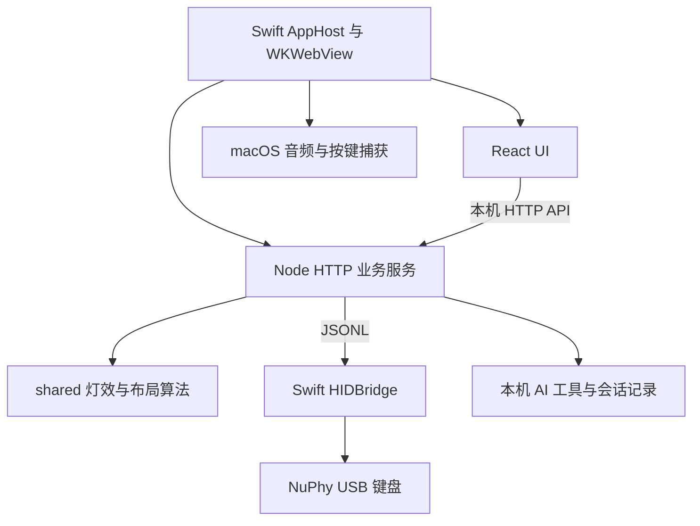
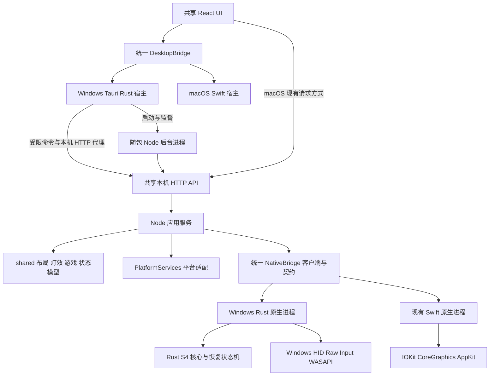

# NuPhy Lab Windows 架构与实施计划

[通俗网页版](WINDOWS_ARCHITECTURE_PLAN.summary.html) · [概要 Markdown](WINDOWS_ARCHITECTURE_PLAN.summary.md)

审核状态：用户已批准 Tauri 的 M0 至 M5 方案，并要求补齐功能后统一人工验收。此前已接入 Air75 V3 精确固件 2.0.0.7 的独立灯光写入与恢复、键位兼容保护、只读准备检查、普通输入和声音异常处理及内部安装包；随后加入新终端恢复和自有控制台切回。本轮在 M4 接入外部原生 Codex 任务的进程关联与窗口导航，并修正运行中进程的存活判断。真实改键仍缺少可靠完成信号，可信 AI 接管未开放；Claude 外部窗口、终端标签页、实体 AI 操作与完整发布仍待完成。目标为 Windows 10 22H2 / Windows 11 x64；此前在独立程序完成的灯光专项不代替本轮验收。更新日期：2026 年 11 月 11 日。

Windows 采用 Tauri 2 桌面宿主，保留 React 界面、Node.js 业务服务及现有作品格式；Node 作为随包提供的后台进程运行，键盘通信和恢复继续由独立 Rust 原生桥接进程负责。平台差异集中在适配层，键盘协议、设备配置与恢复机制通过统一契约和测试样本维护。先验证 Tauri 启动、后台进程和 Windows HID 通信，再逐步完成灯光、交互、声音、AI 集成及安装更新。

首版验收目标为 Windows 10 22H2 x64 与 Windows 11 x64；Windows 11 的具体验收版本在实施前记录。Windows 10 的其他版本、ARM64、Linux 和 WSL 内部工具的自动接入不计入首版验收范围。

## 当前开发进展

本机 Air75 V3 已通过 Windows 原生唯一身份核对：HID 直接读取的 12 位内嵌编号与枚举缓存、USB 复合父节点逐字一致，父节点具有 UniqueID 标记，使用者换 USB 口重插后保持相同。原编号只在原生内存及私有恢复记录中使用，不出现在页面、普通状态 JSON 或文档；不能用接口路径或 ContainerID 代替。证据限本机这把键盘，其他型号和第二把同型号仍待实测。

Air75 V3 2.0.0.7 现在按 `windows-lighting-firmware.json` 独立选择 22 字节、84 键灯/20 侧灯的 Windows 恢复规则。旧版与新版固件的只读镜像用于有界 RV32IMC 运算对照：8192 组颜色、4644 个色相边界、256 次完整调色板渲染和 18 个设置分支。新版主色整数转换独立实现；写设置保留实时图案字段，原调色板先持久化，D8 只发送一次再有限读取确认。Mac 的默认 1.0.23.6 和 Swift 实现不改。未知版本仍在写入前拒绝。镜像来源、摘要、复现方式及 A1 无法区分同号 Beta 构建的限制，见开发指南。

2.0.0.7 的休眠资格单独关闭：实机 F5 未返回确认，程序保留原记录，随后显式恢复核对并归档，灯效、休眠和键位前后未变。最终灯光事务不发送 F3/F5、不创建休眠租约，保留键盘原有自动休眠；开启自动休眠时可能打断长期灯效。只读 F3 四字节检查仍可显式使用，第四字节保留且不猜测含义。旧版休眠规则不变，不能因为灯光可用就扩大休眠或改键资格。

功能键现已接通只读检查：有界 B2 读取当前基础层、B1 读取两个出厂基础层，每层保留全部矩阵与额外键位，以大端数值解析，完整读取两次并核对身份、档位和矩阵。官方虚拟 S4 编码器及解析器的 96 份报文与实现一致。功能键读取资格独立登记，不因为灯光恢复可用而开放改键。Node 依据 Win 出厂层的唯一 F 键位置区分标准、扩展、系统、自定义与共享功能，公共状态只显示用途概要；断连、切档和所有权变化使旧结果失效。设备页显式“读取功能键”，忙碌时禁止另开 USB 读取。这不是持久化恢复备份，也未开放改键、吞键、实体 AI 控制或审批手势。默认只读 v1 新增能力位，旧二进制与新 Node 必须配套更新。三种设备只读检查失败仅返回错误，占用拒绝不会取消正在播放的迎宾动画或其恢复事务。

实机连续三次键位采集一致：当前为 Win 档，但 F1–F12 对应位置实际映射到 F13–F24 扩展键，没有独立标准 F 键。读取前后灯效与休眠设置不变，原应用仍正常响应。扩展映射的来源及恢复归属尚未核对，不能自动当作本应用建立的映射，也不能重置为出厂值。

应用现已补充只读改键准备清单：显式读取后，展示设备和固件候选范围、唯一身份、档位、原设置检查、可进一步核对的标准键、完成确认及可信输入条件；已有扩展映射单独保留，并检查目标键在完整矩阵和额外位置的占用。检查不创建日志、不写键，`canPrepare` 固定为 `false`，也不授予原生资格。原设置仅在同一连接有效的清空检查后显示已检查；恢复完成不能代替新检查。快照随身份、恢复状态、连接和档位失效，页面也核对快照归属。

恢复页面的结果另用独立上下文绑定，完成或失败后仍随断连、固件、档位或身份变化退回“尚未检查”；晚到的旧结果不能显示为新连接成功。界面状态失效不清除原记录或待恢复责任。真实写入确认和可信输入尚未合格，因此这些应用检查不代表改键准备执行入口已开放。验证结果见开发指南。

Windows 应用通过 `WindowsHardware` 组合只读探针和独立原生所有者。只有原生身份、型号、完整恢复固件及物理档位均符合条件，且没有未处理旧记录时，才能基本预览、播放、暂停及停止。持有灯光句柄时由同一原生租约检查状态，不并行用探针访问 USB；Mac 继续使用原驱动。模拟板已验证正常恢复、重新接管、主灯/侧灯输出及退出。

异常重开恢复已从原生库接入应用。设备页提供“检查待恢复记录”，随后在条件满足时通过确认框请求“恢复原设置”。查询不会创建用户恢复目录、设备槽、锁文件或新基线，也不会顺带清理已完成标记；它取得现有系统锁并在原生内存记住活动文件的摘要。恢复必须在本次原生进程先完成检查，再重新核对稳定序列号、完整型号、固件、档位和每个记录的内容；路径、编号、摘要及资格都不由页面提供。记录被修改或删除时，停止恢复，不能把文件消失当作成功。

灯光契约在 v2 接入独立旧记录查询和恢复，v3 增加内置模式，v4 增加连接迎宾准备，当前为 `windows-lighting-v5`，明确功能键记录和独立恢复结果；默认只读桥接仍为 v1。Tauri/Node 预览操作清单当前为版本 14，恢复动作只能携带操作名，页面不能直接调用迎宾私有动作。功能键、RGB 和全局休眠分别尝试、分别读回；成功项归档，失败项保留，其他物理档位延后并提示用户手动切换。完成标记只在明确恢复时核对并续清理；“没有记录”“恢复已验证”“仅清理已完成记录”和“部分失败”分别显示。恢复不建立播放租约，也不自动播放、切档或重放失败写入。

内置模式以独立的 settings-only 租约接入，当前代码仅允许 Kick75 精确固件 4.0.18.6，且原状态已经处于模式 1–20。它不进入逐键模式 21、不改写调色板、侧灯或休眠；只更改请求的主灯字段并独立读回。内置与逐键租约互斥，切换先恢复原设置；动态模式颜色只作采样。原记录复用现有日志格式和冷恢复页面，不引入不能恢复的调色板假备份。Windows Kick75 稳定身份尚未登记，实际入口仍受原生身份门槛限制。4.0.15.6、其他型号及 Air75 V3 2.0.0.7 不因此取得内置写入资格。功能键接管和实体 AI 控制继续待开发。

连接迎宾已接入独立原生准备。只在稳定身份、精确恢复固件、USB 档位和灯位数量符合时给一次机会；旧恢复记录必须先显式处理。第一包设置静音侧灯，调色板先刷盘保存，再写全黑并读取确认所有键灯。首次读取持久调色板可能短暂显示旧颜色，不承诺没有的暗闸门；固件侧灯指示可单独记录，但不能绕过侧灯配置和全键黑帧检查。准备后才开始现有 4.4 秒动画；结束后恢复原设置或交回原场景，用户也可结束或切换。2.0.0.7 可复用该准备，但必须遵守自身原状态与恢复规则。被拒绝的页面请求在串行输出错误处理前校验，执行时再复核，避免无效请求打断动画。真实 Windows 时序、缓冲、插拔和中断恢复仍待验收。

Windows 私有目录仍由 Known Folder API 定位 LocalAppData，固定使用 `NuPhyLab/native-recovery-v1`；只接受当前用户/SYSTEM 的受保护权限，持有祖先及设备目录守卫并拒绝重解析点、网络目录和未知布局。同型号无可靠身份的旧记录不能通过新 token、PID、固件或档位变化绕过；网页、Node 和命令行均不能指定恢复路径。新只读查询复用这些权限与占用检查，并在目录不存在时返回没有记录，不创建目录。

退出先停止调度并优先通知独立原生所有者，再等待在途命令及其他后台清理。宿主必须核对 `windows-host-v2` 本次随机回执、恢复状态、正常进程退出和完整管道结束；零退出码或普通恢复命令不能代替旧记录恢复证明。已观察到的记录及未确认的旧所有者不会被空查询洗掉，部分恢复不能正常确认退出。宿主最多等待 135 秒，不强杀负责恢复的进程；原生失联后仍有独立清理预算。

此前原生开发阶段，Windows 10 当前 Air75 V3 2.0.0.7 已完成有限灯光核对：84 键颜色写入及读回、侧灯更新、明确恢复和原生退出，原 22 字节设置、84 键颜色、四字节休眠及完整键位均逐字一致，无活动恢复记录。原状态为满亮度非白主色的自定义模式，未改动既有 F13–F24 映射。另一次保持事务活动直接退出原生进程，也完成相同恢复与退出核对。 私有历史原记录保留；原应用持续响应，新配套资源未替换到旧窗口。

冷恢复维护工厂返回实际固件，不用型号默认值代替；即使切换的是两个已登记版本，也不能交叉应用原记录。异常重开、进程终止、内容变化和部分恢复由隔离进程验证；实机断电、强杀、窗口保存重开、长期运行、其他键盘和 Windows 11 仍待集中验收。静态画布只发送颜色，动画才附带动画参数，已修复界面请求被严格校验拒绝的问题。

### 本轮原生 Codex 已有任务窗口

M4 新增外部原生 Codex 任务的显式窗口导航。原生探针按任务锁查询资源使用者，完整核对进程创建时间并保留全部候选；Node 只接受唯一目标，核对前后两次身份和发现的本机工具路径。64 位 FILETIME 使用十六进制文本传递，避免数字精度丢失。宿主再按本次请求和时限核对计划，独立打开观察句柄、复核创建时间与程序路径，随后复用独立控制台窗口检查。

页面只提供来源和 UUID，不能指定进程、窗口或输入；清单为版本 14，旧探针拒绝新查询时没有降级跳转。关联只用于用户点击的普通导航，不证明输入控件或审批上下文，也不授予实体手势。只覆盖可核对的传统独立控制台；Claude 外部窗口、Windows Terminal 标签页和敏感输入继续待完成。

一并改用系统句柄判断进程存活，不依赖运行中未定义的退出时间字段。未知、身份变化、多候选或系统拒绝均停止；不结束外部会话。入口尚未进入安装包或实机验收。本地专项 35 项、宿主 21 项、探针 2 项、前端构建及双端目标静态检查通过；共享回归 1159 项中 1158 项通过、1 项按平台跳过。实现 `5270314` 的 546 个源码文件已逐一核对并同步，Windows 全目标 Clippy、宿主 22 项、探针 3 项与专项 35 项通过。自有进程的存活检查不代替实际会话或窗口跳转验收。具体依据与检查见开发指南。

### 此前自有终端窗口核对与切回

M4 新增“切回 Lab 打开的终端”。来源和 UUID 只用于查找本次创建时保留的系统进程句柄，页面不能提供 PID、窗口或输入；没有持有或已退出便拒绝。短时自身子进程在桌面与后台初始化前执行控制台查询，不把 GUI 或键盘恢复所有者附加到终端。

查询核对进程创建时间、控制台成员、可见顶层窗口、类型及系统 `conhost.exe` 所有者，再返回绑定随机请求号、1.5 秒有效的数据。宿主在激活前后复核，失焦、退出、超时、进程/窗口变化或系统不确认时提示手动切换；不向窗口发送任何按键。主程序不调整全局焦点策略，超时只终止自己创建的查询子进程。

该入口只覆盖本次 Lab 创建的传统独立控制台；Windows Terminal 标签页、其他已有窗口及敏感输入上下文继续待完成。代理清单为版本 13，旧宿主未声明能力时不可用。新入口尚未进入安装包或实机验收。本地宿主 20 项、Node 专项 28 项、前端构建、本机及独立 Windows 模块 Clippy 通过；共享回归 1152 项中 1151 项通过、1 项按平台跳过。实现 `27e1248` 的 544 个源码文件已逐一核对并同步，Windows 完整宿主 Clippy、宿主 21 项和 Node 专项 28 项通过，包含既有 Windows 专用安装保护用例。详细边界、来源和检查见开发指南。

### 此前明确操作的新终端恢复

M4 增加显式的新终端恢复入口。网页只给来源和完整 UUID；宿主生成本次随机请求号，后台检查会话、只读索引中的目录、CLI 和进程证据，再给五秒有效的数据计划。宿主只用固定恢复参数创建独立控制台，不继承 Lab 管道或私有环境，不发送消息和按键。已有进程用系统句柄去重，关闭 Lab 不终止用户会话；创建成功只说明已请求终端，不能宣告会话恢复完成。

Codex 仅已完成/空闲记录且未查询到活动写入者可继续，目录两次核对；Claude 另要求明确结束、非活动和原 PID 已不存在。未知均拒绝。查不到写入者不等于已有窗口不存在；此入口不签发物理手势，也不开放已有窗口控制。程序、目录和参数均不由网页指定。代理清单为版本 12，旧宿主未声明能力时页面不可用，Mac 启动方式不变。

实现已进入源码；Node 专项 26 项、Mac 宿主 16 项、前端构建及本机 Clippy 通过，新模块的 Windows API 类型检查通过。本机完整交叉检查因缺 Windows 随包资源停止，未记作通过；随后将实现 `90f6425` 的 542 个源码文件逐一核对并同步至独立 Windows 目录，完整宿主全目标类型检查和同组 Node 专项 26 项均通过。本轮未链接新 GUI、重建安装包或执行真实恢复。新终端输入、目标 CLI 和退出后的终端保留留待统一验收。源码实现与此前 `29a80af` 预览包分别记录；具体边界和来源见开发指南。

### 此前声音失败与会话隔离

独立声音采集使用一次性错误槽，错误不再挤进普通采样/按键队列；主循环停止并等待旧线程结束后直接报告，意外结束同样视为失败。普通声音特征在公开编号前核对当前会话、失败标记和线程存活，已停止或被替换的采样不能重新触发灯效。Node 撤销失败会话并核对启动/停止回执；等待停止时若发生休眠或目标变化，就不启动旧目标。现有应用停止与键盘原设置恢复流程独立保留，用户明确重新开始才建立新采集。

本地原生 13 项及采集、声音、应用退出专项 67 项通过，本地和 Windows x64 目标 Clippy 通过；Windows 原生同组 13 项、Clippy 和专用进程/应用 46 项通过；Mac 共享回归 1142 项中 1141 通过，1 项 Windows 专用检查跳过。首轮混入的 5 个旧 Mac 模拟器用例在 Windows 被协议拒绝，失败日志保留；它们在 Mac 共享回归通过，Windows 运行清单改用现有专用模拟器，未放宽生产限制。完整范围见开发指南。运行源码 `29a80af` 已重新构建完整 GUI 与内部安装包；141 个产物摘要及 129 个运行源码与构建来源一致，六个 EXE 的 x64 架构和包内三套协议退出均通过。产物独立保留，未安装或启动新 GUI。本轮没有改变 v2 报文格式、音频格式或 macOS 实现；真实音频设备和用户数据未操作。声音设备拔插、默认输出变化与休眠的实机验收仍待完成。

### 此前整包构建与输入资格

构建准备和签名产物收集改用 Cargo 元数据提供的实际输出目录，核对工作区、格式版本与绝对路径。外部缓存、中文及空格路径均有实际查询检查；无法取得元数据时停止，不能收集项目默认目录中的旧程序。Windows 的 5 项构建与安装保护检查全部通过；本地 4 项通过，Windows 专用 1 项跳过。完整新 GUI 与未签名内部 NSIS 安装包已由 `c747e7b` 构建，常规安装器 27.24 MiB；141 个产物逐一核对摘要，六个配套 EXE 为 x64，主程序为 GUI 子系统 2。包内 Node/原生互通的只读 v1、灯光 v5 和输入 v2 握手及退出均通过，改键与敏感输入继续关闭。产物放在独立目录，本轮未运行安装器、启动新窗口或替换桌面入口，未打开真实键盘。详细产物与版本记录见开发指南；新窗口、安装、升级、离线包和 Windows 11 仍待验收。

2.0.0.7 的固定镜像检查新增 C1 RAM 开关、64 字节报告构造和一个调用路径的断言；该调用者在报告函数返回后仍继续其他处理。它不能证明完整 USB 格式、原按键抑制、旧模式读回或手势新鲜度。上述资格及生产启用均明确为否，没有启用额外上报模式。普通采集 v2 只用于非敏感灯效触发，真实改键与实体 AI 操作继续关闭。具体偏移、样本与范围见开发指南。

### 功能键事务、兼容保护与恢复底座

新增原生候选改键核心，按 Win 出厂层唯一定位功能键，只计划将标准 F1–F12 临时转为对应扩展键；已有 F13–F24 不创建租约或原记录，自定义与共享用途保持拒绝。保存完整当前基础层、两个出厂基础层和限定修改列表；原记录及意图先刷盘再发一次 B3，完整层独立读回，恢复只还原本次修改的位置并保留其他外部改键。设备、固件、物理档位、矩阵、连接代次与密钥变化均停止。异常重开重新核对稳定唯一身份，完成归档与中断清理后才退场。额外要求传输证明先前 B3 已提交或已拒绝且不会再延迟生效，不能以 ACK 或一次相同读值代替；真实 Windows 传输默认拒绝此能力，在资格补齐前不能创建改键原记录或发出 B3。

该代码与灯光 `Session` 共用原生控制句柄及私有目录锁，键位、RGB、休眠分别清理；部分准备失败留下的记录也不能被 RGB 成功洗掉。共享锚点保留目录守卫和锁的生命周期。新键位原记录纳入恢复观察，v5 要求明确键位待恢复档位、独立结果和完成回执，新旧组件混用在握手阶段拒绝。Node 记住先前待恢复键位，缺少恢复证明时不能因记录消失而报告完成。模拟强制结束后的新进程恢复及清理中断测试通过；加入兼容保护后的 Windows 原生 213 项、配套协议与应用 63 项通过，均为隔离模拟验证，未替换现有桌面 GUI。具体证据见开发指南。

本轮增加独立类型的兼容保护，使用最早原生日志就检查的另一物理档位原文文件名。在限定 Win 档改键前，原键位、兼容保护和意图均须刷盘、独立回读；旧程序会拒绝新接管，且不能将保护解析成有效灯光原文。新版将有效保护归于 Win 键位记录，只有完整恢复的原生证明、归档及持久完成标记建立后才依序退场。原文与保护共用原生系统锁，进程异常退出后仍保留阻断。损坏或缺失的保护使改键停止，孤立保护也不能自动清理。RGB 完成清理只处理本次验证的档位，独立于其他损坏记录。

已用固定旧版本 `7083734` 未修改的 v4 模拟进程与当前代码核对 4 个降级场景，原文保留、设置命令为 0。本地 Rust 209 项、Node/Rust 及异常重开 27 项通过，Windows x64 目标编译检查通过。连接恢复后，`0fd3e22` 的 535 个源码文件已逐一核对并同步至独立 Windows 开发目录，原生 213 项、Node/Rust 63 项和兼容 4 个场景通过。开发工具另收紧握手与唯一退出事件的会话、序号、恢复状态检查；Mac 三种故意损坏回执的负例均被拒绝，双端正常 4 个场景复跑通过。真实键盘未打开，桌面 GUI 未替换；详细依据见开发指南。

当前完成原生组合、v5 协议和应用恢复页面，以及模拟验证，没有开放生产改键入口。官方脚本的 120 组虚拟写入读回样本只证明编码，不代替当前固件真实 B3 行为。固件静态核对已定位存储与有限次忙轮询，B3 回复分支不检查存储返回值，因而仍不能确认失败或丢失回复后的提交边界。固件内部错误锁存受专用模式开关控制，B2 普通读取同样不转交存储返回值；当前未取得可用的完成状态依据。启用前继续取得该依据并实现真实传输确认、应用准备入口与可靠输入来源。当前 v5 和 Windows 页面仍关闭改键、输入接管及实体 AI 操作；真实键盘映射未改变。

### 普通启动与交付入口修复

实际复现了旧调试快捷方式同时打开控制台并抢到前台，以及最小化后重复打开仍不恢复的问题。单实例回调现先恢复窗口，再显示并聚焦；桌面入口已换成完整 Release GUI 程序，直接启动主 EXE，不经 CMD/PowerShell 包装。配套后台与 runtime 全部随目录交付，主程序已核对为 x64 Windows GUI 子系统，各交付文件登记摘要。原项目与用户数据保留，不影响其他项目入口。

Windows 10 普通快捷方式的首次打开、最小化后重复打开、正常关闭后重新打开均通过：重复启动复用同一进程，界面、配套后台和当前键盘已就绪，各次新增可见控制台均为 0。正常关闭取得退出码 0，最后重新打开的主界面保持运行。桌面名称为“NuPhy Lab Windows 预览版”，旧调试入口在核对目标后移除。这是未签名的 GUI 预览目录，不替代签名安装、更新或 Windows 11 验收；本轮没有把启动检查另计作键盘灯光实测。

### 新版实际窗口的专项结果

随后按用户指示，在 Windows 实际桌面启动 `a9b3388` 的 Tauri/WebView2 窗口，使用配套真实后台及 Air75 V3 2.0.0.7。静态图案播放、点击恢复，以及呼吸动画运行中正常关闭窗口均通过；恢复后分别独立读取原 22 字节设置、84 键颜色、四字节休眠及完整键位，均与测试前一致，无待恢复记录，已保存作品不变。未先停止动画后再做退出测试。原草稿记录在关窗前恢复。

该轮灯光退出专项结束时新版已关闭，旧目录保留；后续普通启动修复已更新桌面入口，并将最终主界面保持打开。本轮 PowerShell 退出码采集为 null，未记作 0；以正常关窗请求、进程退出及独立设备/原记录核对共同判断恢复。截图只覆盖当前应用且遮盖作品名称，临时测试连接及任务随验证结束清理。这里只增加当前 Windows 10 设备的窗口证据，整体 M0–M5、Windows 11、断电和长期运行尚未完成。完整过程见[开发与测试指南](WINDOWS_DEVELOPMENT.md)。

### 本轮交互、AI 状态与维护实现

- **独立桌面采集进程**：新增 `nuphylab-desktop-io`，与 HID 写入及恢复进程分开。Raw Input 只观察选定逻辑键，不吞键、不注入、不改键位；先在原生层核对唯一控制接口和输入接口是否属于同一 USB 父节点。编号及路径留在原生内存。任何键盘插拔使旧监听失效，重新启用才建立新代次；Fn 仍留给键盘固件处理。
- **声音特征**：WASAPI 读取默认系统输出或所选麦克风，原生计算音量和八个频段，应用不接收原始 PCM。只有明确开始声音灯效后采集。默认输出更换、采集失败或电脑休眠/唤醒时停止本次效果；不会自动重放旧采样。失效的独立采集进程最多重建三次，每次新会话且不自动恢复监听或采集。
- **Windows AI 状态**：随包 SQLite 以只读、安全模式查询 Codex 本机元数据；原生进程探针使用 PID、启动时间和 Restart Manager 的文件占用证据，无法读取时保留未知。可复制经 PowerShell 字面量转义的恢复命令、打开仍存在的本机项目目录。Claude 钩子采用独立运行时和参数数组，兼容中文、空格及特殊字符路径；保留其他钩子，只记录状态，不记录问题正文。
- **实体 AI 控制边界**：普通按键观察不能签发审批凭证。当前不拦截功能键、不发送 AI 快捷键，也未完成 Windows 实体任务键、审批、听写及目标窗口证明；这些仍属于待完成范围，不能因状态页出现便宣布 M4 交付。
- **维护闭环代码**：Tauri 托盘“退出并恢复键盘”沿用窗口关闭握手；进入官方工具前先恢复并释放 USB。诊断导出采用字段白名单，不导出编号、路径、任务、按键或原始声音。新增常规/离线 WebView2 安装选项与签名发布入口。自动更新只接受配置好的 HTTPS 域名和 NSIS 安装器，要求 Tauri 更新签名、Windows 发布者和时间戳均通过，并在后台恢复回执及进程退出确认成功后才启动安装器。
- **发布前提**：更新配置默认关闭；没有伪造证书、公钥、私钥或线上地址，没有签名或发布新安装包。macOS 保留 Sparkle，Windows 不改 macOS 更新源。Windows/共享 macOS CI 已补充对应构建与检查，但本轮没有推送或运行远程 CI。

Windows 源码按摘要核对同步，只在独立目录构建；原生 177 项和管道/异常重开 25 项通过，旧预览当时仍响应；随后已完成前节的新窗口专项。详细验证、支持条件和剩余工作见 [开发与测试指南](WINDOWS_DEVELOPMENT.md)。


## 当前版本的本地基线

- 源码版本：`package.json` 中的 `1.2.40`。
- 初始提交：`8dfc896fe08ed8a1dce1aa4abab796922de77d2b`。
- 提交信息：`chore(repo): 初始化 NuPhy Lab 1.2.40 本地源码基线`。
- 基线标签：`baseline/v1.2.40`；分支：`main`；共纳入 353 个文件。
- 此基线保留原始源码，未修改实现或安装依赖，未配置远程仓库或推送。

后续方案和开发单独提交，不改写初始化提交。原始快照已有两处空白格式提示，分别位于 `assets/LICENSE.node` 与 `server/hardware.mjs`，初始化时按原样保留。

## 核心功能与现有分层

| 功能 | 主要源码 | Windows 复用与适配范围 |
| --- | --- | --- |
| 多键盘识别与布局 | `shared/keyboard-models.mjs`、布局 JSON、`native/HIDBridge.swift` | 复用型号、画布与 LED 地址；重做 Windows HID 枚举、接口选择和连接生命周期 |
| 逐键绘图与动画 | `ui/src/Studio.tsx`、`shared/render-animation.mjs`、`server/engine.mjs` | 保留创作交互和渲染算法，接入新的原生输出端 |
| 作品库与草稿 | `ui/src/Library.tsx`、`ui/src/draftPersistence.ts`、`server/storage.mjs` | 保持按型号隔离、导入导出及旧作品格式，适配数据目录和文件写入 |
| 原生灯效与侧灯 | `ui/src/NativeLighting.tsx`、`server/hardware.mjs`、`native/HIDBridge.swift` | 复用交互；移植协议、原状态备份、校验与恢复 |
| 按键触发与游戏 | `server/trigger.mjs`、`server/games.mjs`、`shared/typing-cross.mjs` | 复用算法；将 macOS 键码与全局监听改为平台适配 |
| 声音律动 | `server/audio.mjs`、`shared/audio-reactive.mjs`、`native/AudioCapture.swift` | 保留频段驱动效果；Windows 实现麦克风及系统声音采集 |
| Codex 状态与操作 | `server/codex*.mjs`、`shared/codex-lighting.mjs`、原生控制代码 | 保留状态模型与灯效；适配 CLI、索引、进程、快捷键和目标窗口操作 |
| Claude Code 状态与操作 | `server/claude*.mjs`、`hooks/` | 保留事件模型和灯效；适配钩子启动、会话目录、进程及桌面操作 |
| 灯光休眠与连接恢复 | `shared/lighting-power.mjs`、`server/connection-*.mjs`、原生日志 | 保留业务规则，补充 Windows 热插拔、挂起、唤醒和配置切换验证 |
| 桌面与发布 | `native/AppHost.swift`、`native/AppInstance.swift`、`scripts/` | Windows 新增窗口、托盘、单实例、生命周期、安装和更新实现 |

源码包含 AIR75 V3、Kick75、AIR65 V3、AIR100 V3、NODE75 LP/HP、NODE100 LP/HP 共八种配置。当前文档明确指出新增型号实体检查只覆盖 NODE75 LP，其余新增型号还需要实机验证；Windows 必须建立独立验证记录。具体固件范围以 [键盘兼容性](KEYBOARD_COMPATIBILITY.md) 和源码配置为依据，不能把 macOS 的兼容记录直接视为 Windows 已通过。

当前调用关系：



## 已发现的平台耦合与维护问题

- **原生边界较重。** `native/HIDBridge.swift` 有 6105 行，混合了 HID 传输、S4 编解码、恢复日志、按键监听、AI 桌面控制及自测。Windows 移植需要按职责拆分，不能只替换几个系统 API。
- **业务入口集中。** `server/main.mjs` 有 1998 行，直接组合设备、音频、按键、AI 和 HTTP 生命周期。需要先增加依赖注入入口，逐步抽出服务；一次性重写会扩大 macOS 回归面。
- **数据与可执行文件路径绑定 macOS。** 默认数据路径使用 `Library/Application Support/Air Studio`，桥接路径使用 `bin/HIDBridge`；Codex 发现路径、Claude 桌面目录也有平台假设。
- **AI 状态读取依赖系统命令。** `server/codex.mjs` 默认调用 `/usr/bin/sqlite3`，`codex-writers.mjs` 使用 `lsof` 和 `ps`，Claude 会话检测也使用 `ps`。Windows 不能只改路径后继续沿用相同的进程证据。
- **按键契约含 macOS 语义。** 共享触发键包含原生键码，快捷键解析使用 Command/Option；`native-key-auth.mjs` 只接受现有 macOS 事件来源。Windows 必须统一逻辑按键，并扩展可信事件契约。
- **界面直接调用 WebKit 桥。** `ui/src/codexKeys.ts` 和 `ui/src/AudioPanel.tsx` 使用 `window.webkit.messageHandlers`。需要集中为桌面桥接口，避免各组件自行判断平台。
- **音频状态和文案绑定 macOS。** `server/audio.mjs` 包含 macOS 系统声音版本提示，需要改为能力和失败原因驱动。
- **安装更新完全面向 macOS。** `build-native.mjs` 显式拒绝非 Darwin 系统，Node 下载器只处理 Darwin，打包使用 `.app`、签名与 Sparkle。Windows 需要独立构建入口及更新通道。
- **现有测试不能整体照搬到 Windows。** 原生测试编译 Swift，部分服务替身通过 shebang 与 `chmod` 执行。需要可指定解释器与参数的进程启动接口，以及真正的 Windows 测试任务。
- **协议文档存在历史内容。** `native/PROTOCOL.md` 仍有早期 Air75 固定 84 键、104 灯和过时文档链接；新契约需与当前八种配置及实际操作集合对齐。

## 架构选型

| 方案 | 对本项目的影响 | 结论 |
| --- | --- | --- |
| Tauri 2、Node 后台进程与独立 Rust 桥接 | 复用 React 与 Node 业务；Rust 宿主管理窗口和后台进程；系统 WebView 显示界面 | 已批准采用，开发中 |
| Electron 与独立 Rust 桥接 | 可直接承载 React 和 Node 代码，但需要维护额外的 Chromium/Electron 运行时 | 不作为本次实施路线 |
| WPF 或 WinUI 与 WebView2 | 保留 Web UI，新增 Windows 宿主和 Node 生命周期管理；引入另一套宿主交互实现 | 保留为宿主备选，当前不采用 |
| Tauri 并将全部业务重写为 Rust | 除 Windows 原生层外，还需迁移现有 Node 业务服务及其测试，扩大首版范围 | 不纳入首版 |
| 复制现有项目形成 Windows 分叉 | 起步直接，但界面、协议修复和新型号适配需要重复维护 | 不采用 |

Tauri 官方支持把 Node.js 服务或 Node 运行时作为 sidecar 随应用分发，用户无需自行安装 Node。Windows 界面使用 WebView2，Rust 构建目标为 `x86_64-pc-windows-msvc`。具体依赖版本在开发启动时锁定，并分别验证两个目标系统。[Node sidecar](https://v2.tauri.app/learn/sidecar-nodejs/)、[Tauri WebView](https://v2.tauri.app/reference/webview-versions/)、[Rust Windows 支持](https://doc.rust-lang.org/stable/rustc/platform-support/windows-msvc.html)。

Windows 使用 Tauri，macOS 首版继续使用现有 Swift 宿主与 Sparkle。长期共享界面、业务和契约；是否将 macOS 宿主迁移到 Tauri、是否逐步减少 Node 业务，在 Windows 稳定后另行评估。采用 Tauri 不代表已测得特定的安装包大小或内存改善，首版仍包含 Node 和多个进程，需要记录实际数据。



## 模块职责与目录演进

采用增量演进，先在现有目录增加边界，不为了目录整齐而先迁移全部文件。以下为拟议结构：

```text
ui/src/desktop/                 DesktopBridge 类型与宿主实现选择
server/application/            从 main.mjs 逐步提取的应用服务
server/platform/               paths、processes、sqlite、agentEnvironment 等接口
server/platform/darwin/        现有系统能力的封装
server/platform/win32/         Windows 系统能力实现
shared/contracts/              JSON Schema、错误码、能力和键事件定义
shared/devices/                统一设备配置及生成规则
desktop/windows/src-tauri/     Tauri Rust 宿主、窗口、命令权限与进程生命周期
desktop/windows/src-tauri/binaries/  按目标平台准备的 Node 运行时与桥接产物
desktop/windows/resources/      生成的设备配置与随包业务资源
native/windows/                Rust 桥接可执行文件及 Windows API 适配
native/core/                   Rust S4 编解码、设备事务和恢复状态机
tests/contracts/               Swift 与 Rust 共用的报文及恢复场景样本
scripts/windows/               构建、打包、签名、安装验证入口
```

### 共享业务与平台服务

Node 服务管理作品、播放模式、灯光所有权、帧调度及 AI 状态聚合，不直接调用特定平台命令。平台实现仅在组合入口选择，再通过接口注入。

- `PlatformPaths`：数据目录、日志目录、可执行文件路径和 AI 配置位置。
- `ProcessService`：查询存活与启动时间、识别目标程序、管理子进程；无法取得可靠证据时返回未知状态。
- `AgentEnvironment`：区分工具、运行环境和配置根目录，发现 CLI 与会话数据；为未来 WSL 提供扩展点。
- `ReadonlyDatabase`：有界、只读的 SQLite 查询。Windows 首先随包携带固定版本 `sqlite3.exe`，保留现有查询语义；由独立接口隔离，不依赖用户预装 SQLite。
- `DesktopActions`：打开经过验证的 URL 或目录、剪贴板、聚焦目标应用。
- `NativeBridge`：进程启动、握手、请求超时、事件、断线代次及关闭。

Windows 将固定版本的官方 Node 可执行文件按 Tauri sidecar 规则随包提供，`server/`、`shared/`、`hooks/` 等脚本作为资源分发；首版不依赖将整套业务编译为单一可执行文件。Rust 宿主解析资源目录，以绝对路径启动 Node 和受控入口，设置数据目录、临时端口和会话凭据。不会使用用户 PATH 中不确定的 Node，也不向网页开放任意程序启动。[Tauri 外部程序](https://v2.tauri.app/develop/sidecar/)、[Node sidecar](https://v2.tauri.app/learn/sidecar-nodejs/)。

Node 服务继续提供现有本机 HTTP API。Windows WebView 加载应用内置的 React 静态资源，由 `DesktopBridge` 调用 Rust 宿主的有限命令；Rust 再代理到已验证的本机服务地址。这样保持业务 API，又能把端口和认证 token 留在宿主。macOS 继续使用原来的同源 HTTP 请求方式。原生桥接由业务服务以普通子进程启动，使用 stdin/stdout JSONL。

宿主和 Node 增加有界的启动就绪与关闭握手，stdout 只解析指定格式的控制消息，诊断使用 stderr。启动失败、端口未就绪、资源缺失和版本不匹配必须成为明确的界面状态；关闭通过应用协议执行，并检查最终恢复结果，不依赖发送系统信号后直接结束进程。

### 桌面桥与能力声明

`DesktopBridge` 提供业务请求、按键配置、音频控制、更新状态、窗口操作和能力查询。现有 WebKit 调用集中到 macOS 实现，Windows 通过 Tauri 的 `invoke` 和事件接口提供等价方法。`ui/src/api.ts` 在一个入口选择请求实现，业务组件只处理业务方法和能力状态。[Tauri 前端调用 Rust](https://v2.tauri.app/develop/calling-rust/)。

能力采用 `available`、`reason` 和必要的版本字段，至少区分逐键灯效、侧灯、全局按键观察、按键接管、系统音频、麦克风、AI 状态源、具体 AI 操作和应用更新。macOS 权限字段仅由 macOS 使用，不能在 Windows 统一填为 true 来绕过引导。

Tauri capabilities 和应用命令权限只授予主窗口所需能力；自定义命令额外验证窗口来源、操作名、参数和请求大小。前端只使用有限的业务接口，不暴露任意 shell、文件读取或通用 HTTP 代理。外部页面交给系统浏览器，不授予本机控制能力。[Tauri 能力与权限](https://v2.tauri.app/security/capabilities/)。

本机 HTTP 保留随机 token、Host/Origin 校验和回环绑定。普通 UI 命令与原生可信事件分开：按键实体证明、原生权限快照、音频特征等不能通过普通网页命令伪造；这些数据由受信任的原生通道提交。宿主 HTTP 代理仅访问自己启动并完成握手的服务，不接受页面传入任意 URL，也不把会话 token 返回网页。

### 原生协议与恢复核心

保留 `{id, op}` 请求、`{id, ok, result/error}` 响应及无请求 ID 的事件格式。增加握手，返回协议版本、实现版本、平台与能力；过渡期由 macOS 客户端适配现有无握手的 Swift 实现。请求 schema、32 KiB 上限、有限队列、错误码、退出状态及事件序列纳入契约。

Rust 核心不依赖 Tauri 或窗口，负责 S4 报文、固件与几何校验、设备会话及恢复事务；Windows 模块实现传输、输入和音频。原生桥接保持为独立进程，宿主崩溃时仍有机会检测失联并恢复设备；不能因为 Tauri 本身使用 Rust 就把恢复生命周期绑定到窗口进程。首版不直接替换 Swift 协议实现，以共用样本约束两份实现；Windows 稳定后可单独提案将 macOS 设备协议迁入 Rust 核心，逐步减少重复维护。

设备的 VID/PID、矩阵、灯位、画布、固件策略和能力最终由一份版本化配置生成或加载，Swift 与 Rust 都不能长期手写另一份型号表。首轮提取须对比生成结果与现有 Swift 和 JS 配置，避免将 LED 地址、画布索引和矩阵位置混为一体。

## Windows 原生能力设计

### USB 与灯光

Windows 原生进程使用 Rust `hidapi` 接口和 Windows HID 后端，通过系统 HID 栈访问已确认的控制 collection；不要求用户替换键盘驱动。M0 必须确认后端能打开目标接口，失败时停止输出并分析接口属性，不能通过更换到普通打字接口来试探。[Rust hidapi 后端](https://docs.rs/hidapi/latest/hidapi/)。

- 按 VID/PID、usage、collection 和实际 report 描述筛选；macOS 中的 usage page 1、usage 0 仅作为待核对依据，Windows 的实际暴露结果以只读枚举为准。多候选时要求明确选择或拒绝自动连接。
- 协议层固定处理 64 字节 S4 报文，包含协议头；HIDAPI 写入需要额外的 report ID 字节，无编号 report 使用 0。Windows 的 `HIDP_CAPS` report 长度包含这个字节，不能照抄 macOS 的 64 字节筛选条件；读写两侧分别归一化，不能一律剥掉首字节。[HIDAPI 报文约定](https://github.com/libusb/hidapi/blob/master/hidapi/hidapi.h)、[Windows HIDP_CAPS](https://learn.microsoft.com/en-us/windows-hardware/drivers/ddi/hidpi/ns-hidpi-_hidp_caps)。
- 先只读识别固件、灯位、布局和当前状态；全部通过后才允许 `arm`。未知固件和不匹配设备保留只读状态。
- 保持一次请求一个有效响应、输出背压和旧帧丢弃，禁止堵塞后追放过期动画。以现有 30 FPS 调度为初始目标，实测持续帧率与响应延迟。
- 首次写入前持久化原灯效；自定义调色板、主灯、侧灯、灯光 profile 和休眠租约分别记录。Win/Mac 物理开关改变时重新验证当前 profile，保留另一个 profile 的恢复记录。
- 正常退出、升级、断线和模式切换均执行恢复；失败保留原记录，并明确暴露 `recoveryPending`。断电或进程本身崩溃不能保证即时恢复，下一次连接需先核对设备身份与恢复记录。
- 无序列号设备采用受限的本机身份策略；USB 端口变化或身份不确定时不把旧备份自动写到新设备。恢复日志与普通作品不能互相导入。

### 按键与快捷控制

逻辑按键统一为 `KeyboardEvent.code` 或明确的 HID usage，不把 macOS keyCode 当作通用标识。Windows 扫描码、虚拟键码和左右修饰键在输入适配层转换，显示文案根据平台生成。

Raw Input 的 `hDevice` 用于识别事件来源，但它不是逐键拦截接口；低级键盘钩子的事件结构也不能直接提供相同的设备身份。因此不以时间接近的两条事件作为敏感操作的可靠来源证明。[Raw Input 设备标识](https://learn.microsoft.com/en-us/windows/win32/api/winuser/ns-winuser-rawinputheader)、[低级键盘钩子](https://learn.microsoft.com/en-us/windows/win32/winmsg/lowlevelkeyboardproc)。

当前普通采集契约升级为 v2，要求连续事件序号及 `orderedKeyEvents` 能力，旧采集程序在握手时拒绝。原生独立失效标记让满队列、设备变化和线程结束都能停止旧监听，重置不依赖原事件队列；旧代次事件在编号前丢弃。原生和 Node 分别去重按下/松开，合并同一键盘多输入接口的按下状态；Node 的启动缓存有数量及接收后等待时限。输入异常撤销应用触发代次，停止灯效、等待恢复并提示重新启用。Windows 原生 10 项及应用/进程 118 项模拟检查通过；这仍是 `sensitiveKeys: false` 的普通观察，不会签发 AI 手势或抑制普通输入。实际验证和交付范围见开发指南。

M0 先验证目标键盘在 Win 档的 F 区、consumer 键和旋钮事件：

1. 先完成不吞键的按键观察，供触发灯效使用；游戏保留应用聚焦输入。
2. 优先使用经验证的独立控制报告，或可备份恢复的专用键位租约，为 AI 命令提供明确的设备来源。
3. 裸 F1–F12 的后台接管单独验证。不能可靠避免系统或前台应用同时响应时，不宣称已完成接管；提交明确的降级方案或范围调整供审核。
4. AIR65 没有实体 F 区，继续按型号能力处理；蓝牙快捷控制列为后续扩展，不等同于 USB 灯效支持。

可信按键事件包含来源、设备会话、绑定代次、递增序号、手势 ID 和 down/up，保留现有签名与防重放思路。捕获进程持有签名能力，页面不得签发实体按键证明。忽略合成事件和重复按下；绑定变更、失焦、拔插及退出时释放已持有的按键。

桌面按键投递使用经目标校验的 Windows API；`SendInput` 受 UIPI 完整性级别限制，不能保证控制以更高权限运行的应用，也不以常驻管理员方式解决。批准、拒绝、发送及听写须验证目标进程、上下文和实体手势；能力不足时禁用操作，不能把 Enter/Esc 发给任意前台窗口。[SendInput 限制](https://learn.microsoft.com/en-us/windows/win32/api/winuser/nf-winuser-sendinput)。

### 音频采集

Windows 使用 WASAPI 麦克风采集及 loopback 系统混音采集；默认使用选定输出设备的系统混音，不做单应用隔离。loopback 采用 shared mode，可在没有硬件“立体声混音”设备时工作。[WASAPI Loopback](https://learn.microsoft.com/en-us/windows/win32/coreaudio/loopback-recording)。

原始 PCM 留在原生进程，统一输出 RMS、频段、节拍所需特征和会话 ID。复用现有声音效果，测试 44.1/48 kHz、单声道/立体声、静音、设备切换和默认输出变化。麦克风授权、设备失效、受保护音频无法捕获及挂起恢复按真实状态显示，去除 macOS 专属提示。

## AI 集成与环境边界

保留现有数据来源和状态模型，但为 Windows 增加环境发现与版本探测。首版接入原生 Windows 工具；WSL 预留独立环境 ID、路径映射和事件适配器，不自动扫描发行版或把 Linux 进程 ID 当作 Windows 进程 ID。

- Codex 索引和事件只读查询经 `ReadonlyDatabase` 与环境适配器完成；CLI 发现不依赖 `/Applications`。无法替代 `lsof` 的写入者证据时，不仅凭文件修改时间宣布“运行中”，应返回未确认状态。桌面深链、额度读取与每项命令分别探测。
- Claude Code 复用钩子事件 worker，Windows 启动命令按实际 shell 生成并测试；不能直接执行 `.sh` 或使用 POSIX quoting 处理 PowerShell/cmd 路径。钩子运行时应有升级后稳定的路径，不把某个版本安装目录中的临时位置写死到用户配置。
- 仅修改应用拥有的钩子条目，保留用户配置和备份；保留现有 Claude Code 不代批权限请求的行为。
- 进程身份至少考虑 PID、启动时间和程序身份，防止 PID 重用；会话来源与桌面目标无法关联时，提供项目目录或恢复命令等已确认的操作。
- Windows 恢复命令按目标 shell 生成；快捷键使用实际配置，不能机械地将 Command 替换成 Ctrl。
- 发布前提供逐项兼容表：状态灯、任务跳转、普通命令、旋钮、批准/拒绝、发送和听写分别标为已验收、受限或不可用。高级 AI 操作的对等支持仍属目标；若 M0 证明无法可靠实现，先提交方案变更审核，不以隐藏按钮当作原目标全部完成。

## 数据与进程生命周期

Windows 默认数据目录拟定为 `%LOCALAPPDATA%\NuPhyLab`，保持应用标识和目录稳定，升级不随安装版本变化。作品文件保持 `air-studio` 导出格式与按型号分库规则，schema 升级先备份再写入；Mac 的默认目录与现有数据继续保留。

迁移和导入只转移作品及允许跨平台的设置，输入映射、授权状态、设备恢复日志和平台专属快捷键单独处理。Windows 文件适配覆盖 Unicode、空格、长路径、大小写、重命名冲突、符号链接或 reparse point、文件占用及杀毒扫描，不假定 POSIX chmod 和 O_NOFOLLOW 能提供同样保证。

关闭顺序为：拒绝新命令 → 停止采集与帧调度 → 释放持有按键 → 恢复键盘及租约 → 刷盘 → 关闭进程。先通过应用级消息关闭，不能依赖 Windows 的 `SIGTERM` 语义完成恢复。原生进程监控管道 EOF 和父进程实际存活状态，宿主失联后仍有恢复机会；不把“父 PID 数值未变”当作存活证明，也不在宿主崩溃时立刻强杀负责恢复的进程。超时强制退出须留下可检查的恢复记录。

## 安装更新与长期维护

Windows 使用 Tauri 的 NSIS 安装路线，优先提供用户级安装；自动更新使用 Tauri updater 的签名产物和平台更新元数据。正式构建与签名放在 Windows runner 上完成。[Tauri Windows 安装](https://v2.tauri.app/distribute/windows-installer/)、[Tauri 更新插件](https://v2.tauri.app/plugin/updater/)。

安装过程检查 WebView2。常规包可按官方安装方式补齐运行时，离线安装包需要携带对应的离线运行时；两者分别验证，不能假定所有 Windows 10 电脑都已经安装。M0 同时记录实际包大小、启动时间及宿主、WebView、Node 和桥接各进程占用。正式交付前明确是否同时提供在线和离线包。

- 保留 macOS Sparkle 通道，Windows 更新源按平台、架构和 stable/beta 分开；不会写入现有 macOS appcast。
- 构建时锁定 Tauri、Rust、插件、WebView2 分发策略、HID 后端、Node 和随包 SQLite 版本及校验值；Windows 服务使用随包 Node，钩子的独立运行时单独管理，不让用户手工安装依赖。
- 正式分发要求 Windows Authenticode 签名和时间戳，验证安装器及随包可执行文件身份；Tauri 更新签名与 Windows 代码签名分别管理。更新走 HTTPS，验证更新签名和可信发布者，具体验签行为纳入安装更新实测，不能把下载成功当成验签通过。
- 升级前必须确认键盘恢复及进程释放；验证延后、失败、重试、旧版升级与数据保留。卸载默认保留作品，清理自有钩子需要明确入口。
- 产品版本、原生协议版本、作品 schema 和设备配置版本分别管理；发布记录说明两个平台实际交付范围。
- 采用单仓库、短期功能分支和小步提交；不建立长期 Windows 业务分叉。修改共享逻辑必须检查两个平台。
- 建立 macOS/Windows CI；Windows 10 的安装和硬件测试使用固定环境，不能只靠较新 Windows runner 代替。
- 维护设备与固件兼容表、架构决策、脱敏诊断及验收记录。新增型号优先变更公共设备配置，并补协议样本及硬件证据。

## 实施顺序与交付条件

计划批准后按以下顺序连续实施。M0 验证通过后，M1 至 M5 在批准范围内推进；如果核心方案、功能范围或依赖前提发生实质变化，先更新计划并重新审核。

| 阶段 | 拟改动与交付 | 通过条件 |
| --- | --- | --- |
| M0 Tauri 与 Windows 技术验证 | 锁定工具链；最小 Tauri 宿主、Node sidecar 和只读 HID 探针；验证请求代理、关闭握手和 WebView2 安装；确认 Win 档按键与 AI 目标能力 | Windows 10/11 x64 均可启动；真实键盘只读识别和输入来源明确；记录包大小、启动和进程占用；报告接管与 AI 操作的可行路径 |
| M1 跨平台基础 | 增加 PlatformServices、DesktopBridge、原生契约、可配置启动参数、数据路径与测试替身；封装 macOS 现状 | 共享测试通过，macOS 原行为回归通过，Windows 可离线创作、保存、导入导出 |
| M2 USB 灯光闭环 | 移植 S4 核心、设备配置、逐键/侧灯、原生灯效、备份恢复、断线代次和休眠租约 | 优先用 AIR75 V3 与 Kick75 完成连接、绘图、动画、恢复及拔插测试；未知设备无写入 |
| M3 交互与声音 | Windows Raw Input、逻辑键码、触发、游戏、已验证的功能键方案与 WASAPI 特征采集 | 按键来源正确，无卡键；采集不传输原始 PCM；睡眠唤醒、音频切换通过 |
| M4 AI 集成 | Windows CLI/会话/进程/SQLite 适配，Claude 钩子、桌面动作、可信手势及命令能力探测 | 用真实目标工具逐项验收状态灯与操作；不误报状态、不误投递按键、不误触审批 |
| M5 安装与维护闭环 | Tauri NSIS 构建、WebView2 分发、签名更新、卸载、诊断、文档和完整设备验收 | 干净 Windows 10/11 的安装、运行时补齐与旧版升级通过；作品保留；平台和型号兼容表完整 |

M2 可形成内部测试版，M3/M4 可形成公开测试候选；只有 M5 的验收范围完成后，才能声明相应 Windows 正式功能已交付。八种型号逐一维护验证状态，未完成实机验收的配置不能标为正式支持。

### 计划涉及的已有文件

- `server/main.mjs`：改为平台组合入口，增加宿主就绪及关闭握手，逐步抽出应用服务，保持现有 API 与业务规则。
- `server/hardware.mjs`：支持可执行文件加参数的启动描述、能力握手与兼容适配，保留串行请求、输出校验和会话隔离。
- `server/codex*.mjs`、`server/claude*.mjs`、`hooks/`：隔离系统命令、环境发现、快捷键和钩子启动器。
- `server/audio.mjs`、`ui/src/api.ts`、`ui/src/AudioPanel.tsx`、`ui/src/codexKeys.ts`、`ui/src/types.ts`：改为能力驱动的桌面桥和状态表示；Windows 请求通过 Tauri 命令接入，macOS 保留原方式。
- `shared/keyboard-models.mjs`、相关 JSON、按键定义：提取统一设备描述和逻辑键标识，保持旧作品索引兼容。
- `desktop/windows/`：在审核后新增 Tauri 宿主、应用命令权限、资源与 sidecar 配置、单实例和托盘生命周期。
- `package.json`、`scripts/`、`.gitignore`、测试配置：在审核后新增 Windows 依赖准备、开发、构建和 CI 入口，忽略 Rust 与打包产物，保留 macOS 命令；原生代码和依赖按模块新增。

## 验证方案与主要风险

当前工作环境为 macOS Apple Silicon，已安装开发依赖并进行本机构建和隔离测试。用户已确认有 Windows 电脑和 NuPhy 键盘；完整 Windows 编译、安装与硬件验收仍需在对应电脑执行。测试范围与操作入口见 [开发与测试指南](WINDOWS_DEVELOPMENT.md)。

验证分为四层：

1. 共享业务：现有 `npm test`、UI 类型检查与构建，覆盖模型、作品兼容、渲染、模式切换和状态灯；依赖替身不能执行真实 AI 操作。
2. 契约与原生核心：报文与 checksum 样本、错误长度、超时、半包、队列上限、断线代次、profile 切换、恢复冲突、事件签名和防重放；Swift/Rust 对同一输入核对结果。
3. Windows 宿主集成：Tauri 命令权限、页面伪造原生事件被拒绝、sidecar 启动失败、运行时与资源路径、原生崩溃、宿主崩溃、单实例、托盘、路径特殊字符、文件占用、WebView2 缺失、安装升级和卸载；macOS 同时回归。
4. 实机：逐型号测试绘图、动画、侧灯、原生灯效、F 区、旋钮、触发、游戏、系统/麦克风音频、连续拔插、系统休眠与键盘档位切换，退出后读回原设置。

主要风险逐项处理：

- **HID collection 与报文差异。** M0 以描述符和只读响应验证，未经确认不开放写入。
- **功能键接管与实体来源。** M0 优先验证来源和吞键边界；有不可靠环节则调整方案并重新审核。
- **恢复错误导致设备设置残留。** 持久化日志、设备/profile 绑定与读回验证作为 M2 的完成条件，故障场景先于长时间播放验收。
- **AI 工具版本与接口变化。** 各动作独立探测，支持未知状态和明确失败原因；升级只影响对应适配器。
- **原生层重复维护。** 首版用统一设备数据和契约样本约束 Swift/Rust；后续是否共用 Rust 核心单独评审。
- **Windows 10 与 WebView2 环境差异。** 验证 WebView2 缺失、更新、离线安装及界面兼容；Tauri 或原生依赖升级后重新验证最低系统要求。
- **Node sidecar 与多进程生命周期。** 针对资源路径、就绪握手、关闭超时、宿主崩溃和后台残留分别测试，不假定 Tauri 会自动完成业务恢复。
- **缺少实体与 Windows 环境。** 可先推进共享层和模拟测试，但不能将这些结果替代真实 Windows 安装、USB 或 AI 操作验收。

## 已批准范围

用户已明确批准按更新后的 Tauri 方案开发，包括 Windows 10 22H2 与 Windows 11 x64、Tauri 2 宿主、随包 Node 后台服务、独立 Rust 原生桥接、受限命令代理、NSIS 安装与 Tauri 签名更新，以及 M0 至 M5 的实施顺序。先完成 M0，在技术验证结果支持方案时继续实施；出现实质方案或范围变化时重新提交审核。

远程推送、对外发布、替换已安装应用和 PR 合并不在本次计划批准范围内。
